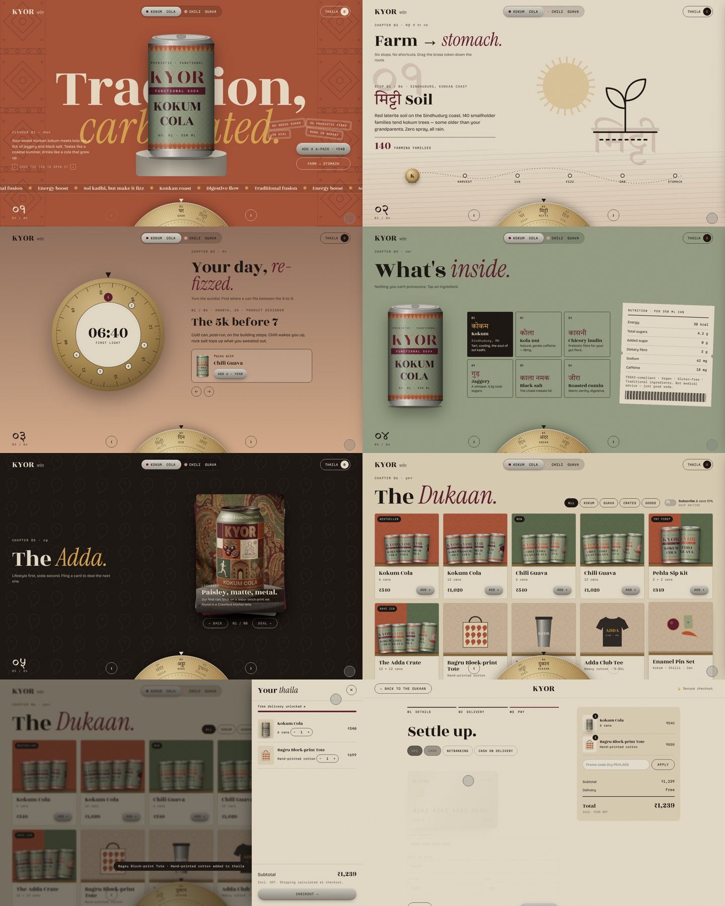
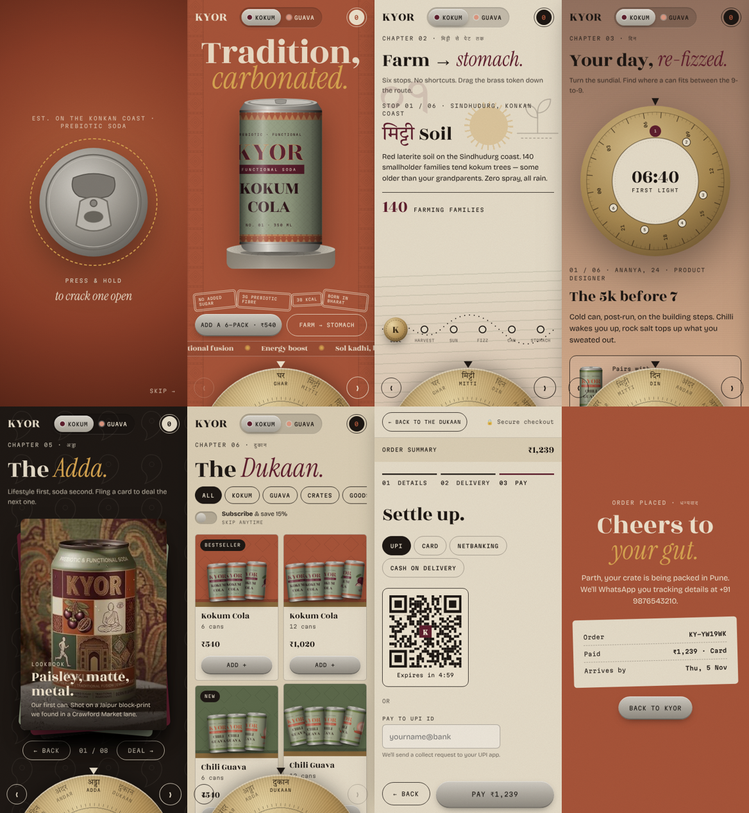

# KYOR — Tradition, carbonated

A design-forward, lifestyle-first website for KYOR, an Indian prebiotic soda brand
(Kokum Cola and Chili Guava). It's a standalone static site: no build step and no dependencies.

```bash
cd kyor && python3 -m http.server 8080   # then open http://localhost:8080
```

## Interaction model: one chapter at a time, no long scroll

The site is a set of six full-screen **chapters**. You move between them with the **brass dial**
at the bottom of the screen (drag it or tap a label), the arrow buttons, the mouse wheel,
the arrow keys or 1–6, or a horizontal swipe on mobile. Each move plays a block-print shutter
transition with the chapter's Hindi name.

| # | Chapter | Signature interaction |
|---|---------|-----------------------|
| 01 | **Ghar** (home) | Drag the can to spin its wrap-around label (with inertia). The flavour switch re-themes the whole site. |
| 02 | **Mitti** (farm → stomach) | Drag the brass token along the route: soil → harvest → sun → fizz → can → stomach. The sun moves with you. |
| 03 | **Din** (a day) | Turn a 24h sundial. The sky changes colour and each moment pairs a flavour with a real routine. |
| 04 | **Andar** (inside) | Ingredient tiles (Hindi and English, with origins) and a nutrition "ration ticket". |
| 05 | **Adda** (lifestyle) | Fling a deck of cards: lookbook, manifesto, playlist, events, recipes, merch. |
| 06 | **Dukaan** (shop) | Storefront with filters, a 15% subscribe-and-save toggle and a *thaila* (bag) drawer with a free-delivery meter. |

**Checkout** is a 3-step flow: details → delivery (fills in the city from the pincode, shows a delivery estimate)
→ payment (UPI QR/ID, a live metal card preview that flips for the CVV, netbanking, COD), with promo codes
(`PEHLA10`, `ADDA15`), GST shown and a success ticket.

A press-and-hold "crack the can" intro plays once per session.

## Files

- `index.html`: page structure
- `css/kyor.css`: design tokens (flavour themes are on `:root[data-flavour]`) and all styles, including responsive rules
- `js/data.js`: **all copy, products, prices and moments live here**
- `js/can.js`: procedural SVG cans and product art
- `js/app.js`: chapters, dial, gestures, the interactions above, storefront and bag
- `js/checkout.js`: checkout validation and the simulated payment
- `assets/`: the tested can renders

## Going live

`processPayment()` in `js/checkout.js` is the integration point. Create an order on your server, then open
Razorpay, Cashfree or Stripe checkout there. The UPI QR is a decorative placeholder until then.
Health copy is phrased as traditional use. Have it checked against FSSAI advertising rules before launch.

## Preview



